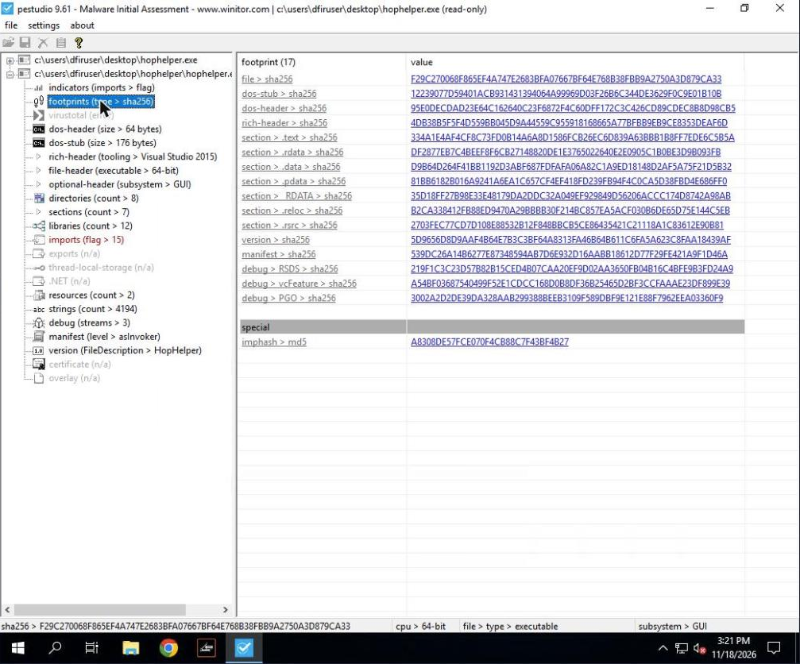
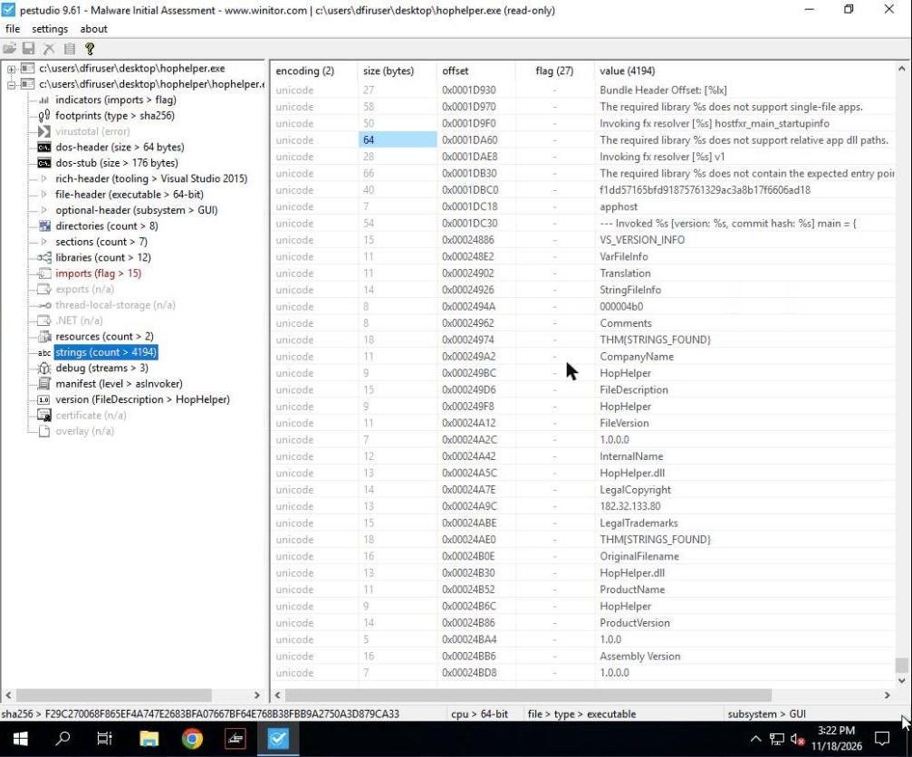
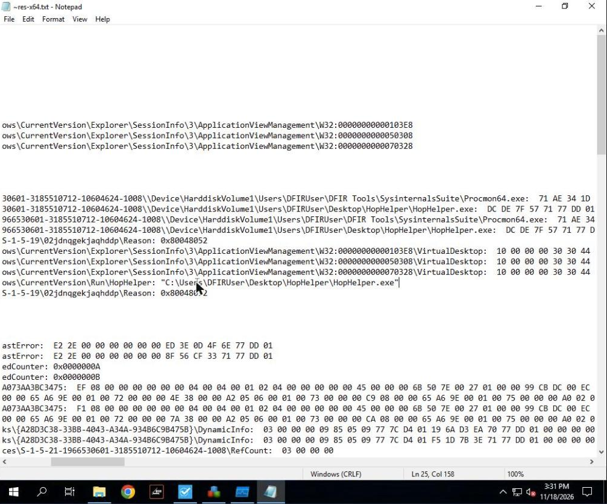
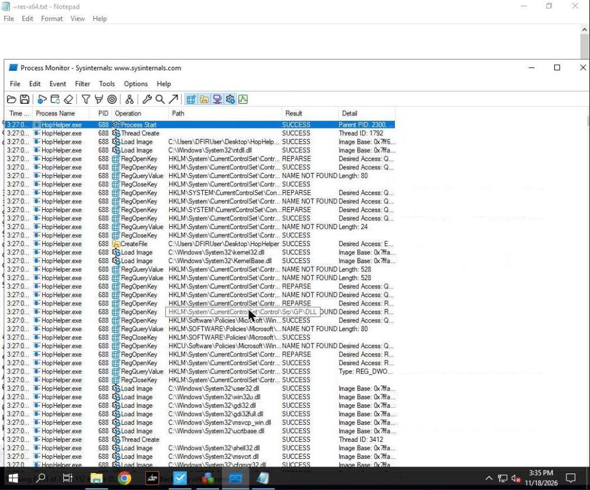
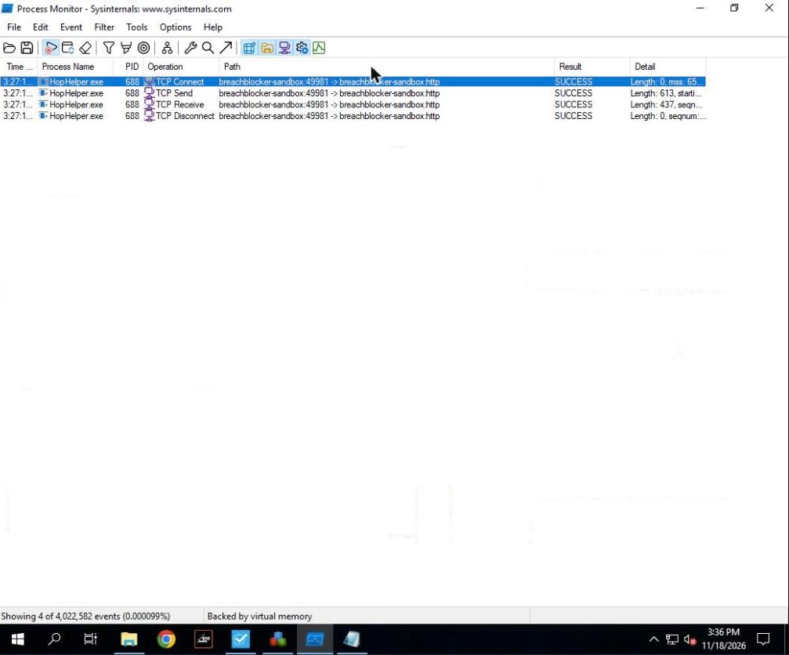
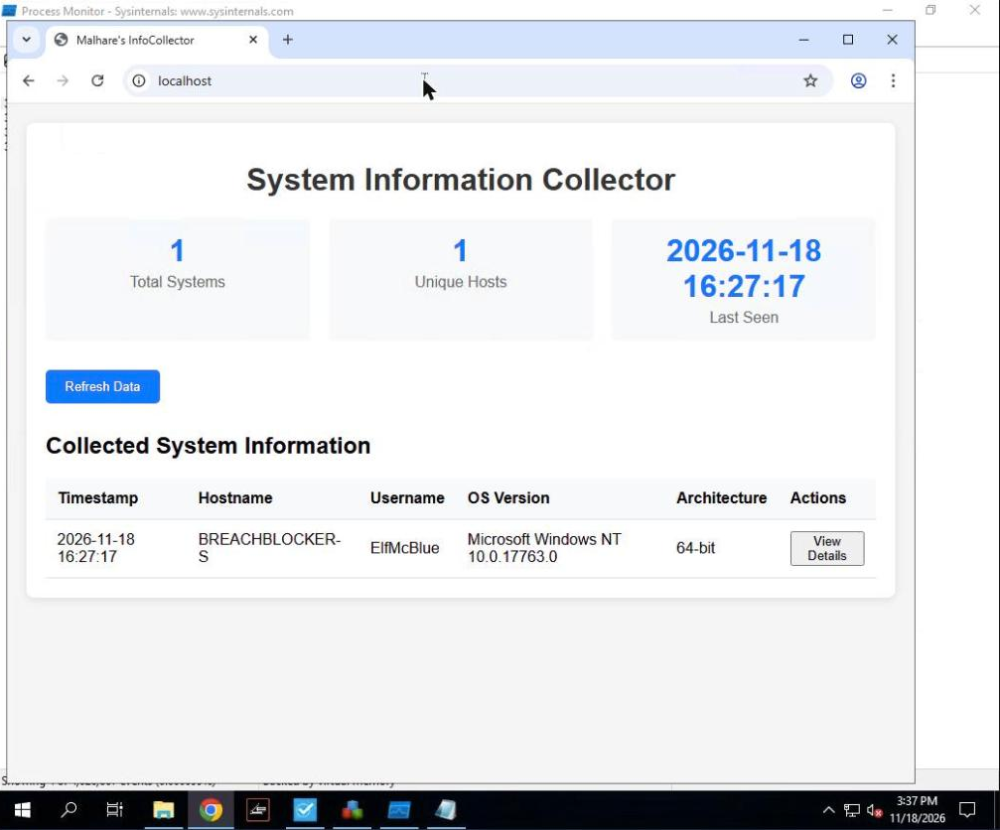

# TryHackMe – Malware Analysis: Egg-xecutable (Advent of Cyber 2025, Day 6)

## 1. Objective

Analyse the suspicious `HopHelper.exe` sample inside an isolated Windows sandbox and work out:

1. What it is (file hash, embedded strings) **without running it** – static analysis.
2. What it does to the system when it **does** run (persistence, network activity) – dynamic analysis.

## 2. Key concepts

| Concept | What it means | Why it matters here |
|---|---|---|
| **Sandbox** | An isolated, disposable machine (often with snapshots) where untrusted code can run without touching real systems. | The golden rule: never detonate malware on a device you care about. All execution in this report happened inside the THM lab VM. |
| **Static analysis** | Inspecting a file without executing it (hashes, strings, imports, resources). | Fast and safe, gives IOCs, but can be fooled by obfuscation/packing. |
| **Dynamic analysis** | Running the sample and watching its behaviour (registry, files, network). | Shows what the sample actually *does*, which static analysis can only guess. |
| **SHA256 hash** | A unique fingerprint of the file's bytes. | Used as threat intel – can be shared, blocked or looked up (e.g. VirusTotal). |
| **Strings** | Readable character sequences inside the binary. | Often leak IPs, URLs, commands, flags or credentials. |
| **Persistence (Run key)** | Values under `...\CurrentVersion\Run` are launched automatically at user logon. | A classic way for malware to survive a reboot. |
| **Regshot** | Takes a registry snapshot before and after execution, then diffs them. | Quickly reveals keys/values the sample created or modified. |
| **ProcMon** | Logs every file, registry, process and network event in real time. | Filtering by process + operation isolates exactly what the malware did. |

## 3. Lab environment

The sandbox VM (`breachblocker-sandbox`, Windows 10, x64) had the analysis tools on the Desktop and the sample in the `HopHelper` folder.

*Figure 1 – Analyst VM desktop with Regshot, PeStudio, ProcMon and the HopHelper folder.*

---

## 4. Static analysis (PeStudio)

### 4.1 File hash

`HopHelper.exe` was loaded into PeStudio (`file > open`). The **footprints** view lists the file's SHA256 along with hashes of each PE section and header. PeStudio also identified it as a 64-bit GUI executable built with Visual Studio 2015 tooling, with 15 flagged imports.

*Figure 2 – PeStudio footprints: `file > sha256`.*

> **SHA256:** `F29C270068F865EF4A747E2683BFA07667BF64E768B38FBB9A2750A3D879CA33`

### 4.2 Strings

PeStudio found 4,194 strings. Scrolling to the bottom (the Unicode strings stored in the version-info resource) showed the flag twice – in the `Comments` and `LegalTrademarks` fields – plus an IP address, `182.32.133.80`, stored in the `LegalCopyright` field. An IP sitting in a copyright field is an IOC worth noting.

*Figure 3 – Strings view showing `THM{STRINGS_FOUND}` and the embedded IP.*

> **Flag:** `THM{STRINGS_FOUND}`

---

## 5. Dynamic analysis

### 5.1 Baseline registry snapshot (Regshot – 1st shot)

Before executing anything, Regshot's output path was set to the Desktop and the **1st shot** was taken (≈405k keys, 822k values). Process Monitor was then started so it was capturing when the sample ran.

*Figure 4 – Regshot with output path set to the Desktop.*

*Figure 5 – First snapshot complete (Keys: 405205, Values: 822647); 2nd shot now available.*

### 5.2 Executing the sample

`HopHelper.exe` was double-clicked from the HopHelper folder. Two visible effects:

- All desktop shortcut icons were replaced with an Easter-egg icon (the bundled `egg.ico`).
- A message box appeared: *"King Malhare sends his regards"*.

*Figure 6 – Desktop icons replaced right after execution.*

*Figure 7 – HopHelper's pop-up message.*

### 5.3 Registry changes (Regshot – 2nd shot + Compare)

After the **2nd shot**, **Compare** produced the diff log (`~res-x64.txt`): 3 keys added, 10 values added, 35 values modified. Most were normal Windows noise (BAM entries, SessionInfo). The important one is a new value under the user's **Run** key:

*Figure 8 – Regshot compare log; the Run\HopHelper value is in the "Values added" section.*

*Figure 9 – Full value: the Run key points at the HopHelper executable.*

> **Persistence key:**
> `HKU\S-1-5-21-1966530601-3185510712-10604624-1008\Software\Microsoft\Windows\CurrentVersion\Run\HopHelper`
> **Data:** `"C:\Users\DFIRUser\Desktop\HopHelper\HopHelper.exe"`

`HKU\<SID>` is the logged-in user's hive, i.e. the same location as `HKCU\Software\Microsoft\Windows\CurrentVersion\Run`. HopHelper will therefore relaunch every time this user logs in (MITRE ATT&CK **T1547.001 – Registry Run Keys / Startup Folder**).

### 5.4 Process and network activity (ProcMon)

The ProcMon capture was stopped and filtered:

1. `Process Name` **is** `HopHelper.exe` → Include
2. `Operation` **contains** `TCP` → Include

*Figure 10 – ProcMon filter configuration.*

With only the process filter applied, you can see HopHelper start, load its DLLs, query policy registry keys and create files.

*Figure 11 – Events for HopHelper.exe (PID 688).*

With the TCP filter added, only four events remained: **TCP Connect → TCP Send (613 bytes) → TCP Receive (437 bytes) → TCP Disconnect**, all going to `breachblocker-sandbox:http`, which is port 80.

*Figure 12 – HopHelper's TCP traffic to the `http` port.*

> **Protocol:** `HTTP`

A single request/response like this is consistent with a beacon that **uploads host information** and gets a reply.

### 5.5 Bonus – the web panel

Because the traffic went to the sandbox itself on HTTP, `http://localhost` was opened in Chrome on the VM. It hosts **"Malhare's InfoCollector – System Information Collector"**, which had already received this machine's details from HopHelper: hostname `BREACHBLOCKER-S`, user `ElfMcBlue`, OS `Windows NT 10.0.17763.0`, 64-bit.

*Figure 13 – Attacker-style collection panel showing the victim's system info.*

---

## 6. Answers

| # | Question | Answer |
|---|---|---|
| 1 | SHA256Sum of HopHelper.exe | `F29C270068F865EF4A747E2683BFA07667BF64E768B38FBB9A2750A3D879CA33` |
| 2 | Flag in the strings | `THM{STRINGS_FOUND}` |
| 3 | Registry value modified for persistence | `HKU\S-1-5-21-1966530601-3185510712-10604624-1008\Software\Microsoft\Windows\CurrentVersion\Run\HopHelper` |
| 4 | Network protocol used | `HTTP` |
| 5 | Bonus – web panel | Malhare's InfoCollector (System Information Collector) at `http://localhost` |

*Figure 14 – Room completed.*

## 7. Indicators of compromise (IOCs)

| Type | Value |
|---|---|
| SHA256 | `F29C270068F865EF4A747E2683BFA07667BF64E768B38FBB9A2750A3D879CA33` |
| File path | `C:\Users\DFIRUser\Desktop\HopHelper\HopHelper.exe` |
| Registry | `HKCU\Software\Microsoft\Windows\CurrentVersion\Run\HopHelper` |
| Network | HTTP (TCP/80) beacon to the collection panel |
| String / IP | `182.32.133.80` (embedded in version info) |
| Behaviour | Replaces desktop shortcut icons; shows "King Malhare sends his regards" pop-up |

## 8. Defensive recommendations

- **Block the hash** in EDR/AV and hunt for it across endpoints.
- **Monitor Run keys** (Sysmon Event ID 13, or Autoruns) for new entries that point to user-writable paths like Desktop or AppData.
- **Watch egress HTTP** for small POST-style beacons from unsigned binaries; block `182.32.133.80` at the perimeter.
- **Remediation on an infected host:** kill the process, delete the `Run\HopHelper` value, remove the binary, and restore the shortcut icons.

## 9. Conclusion

Static analysis gave fast IOCs (the hash, a flag and an IP) without any risk. Dynamic analysis confirmed the real behaviour: HopHelper sets up persistence through the user's Run key and sends host information over HTTP to a collection panel. Using both approaches together, in a sandbox, gives a complete picture of the sample, and that picture translates directly into detection and blocking rules.