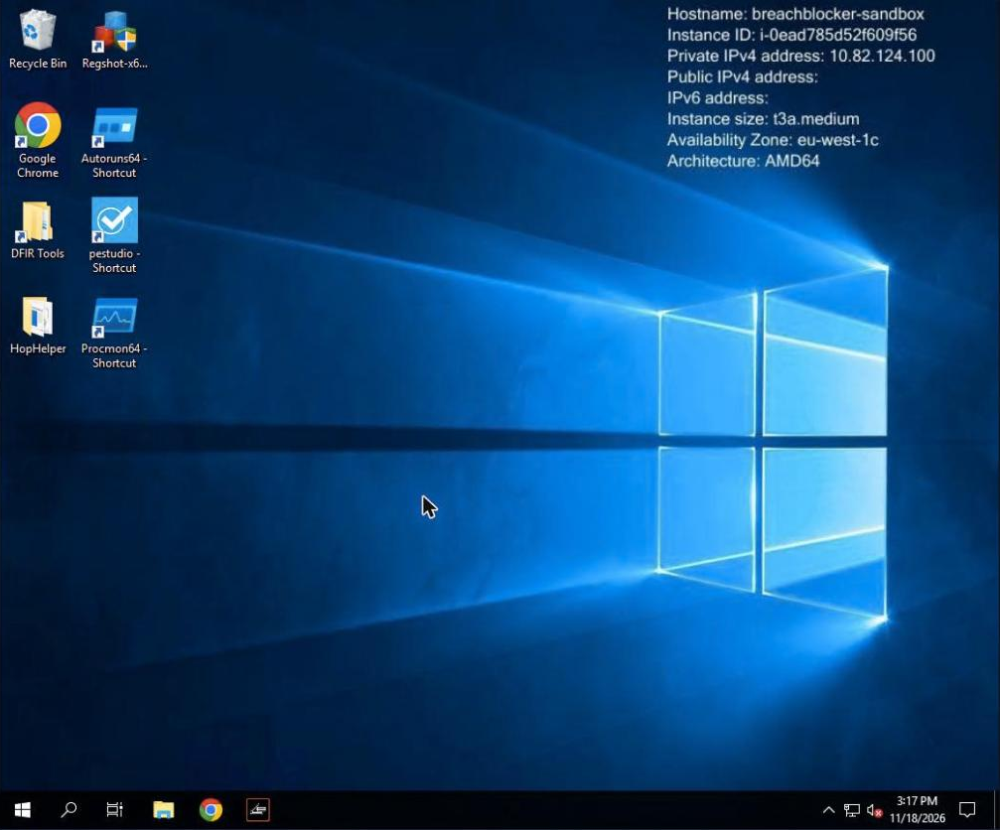
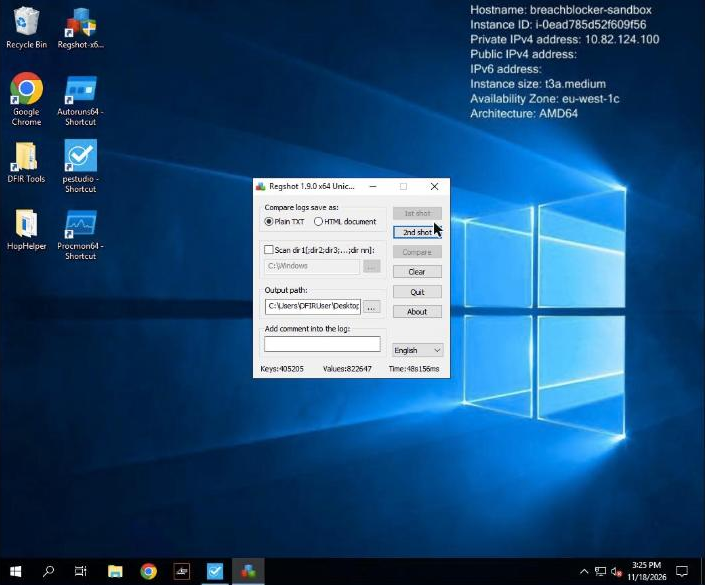
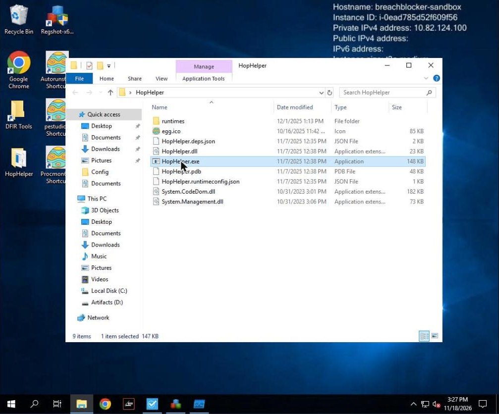
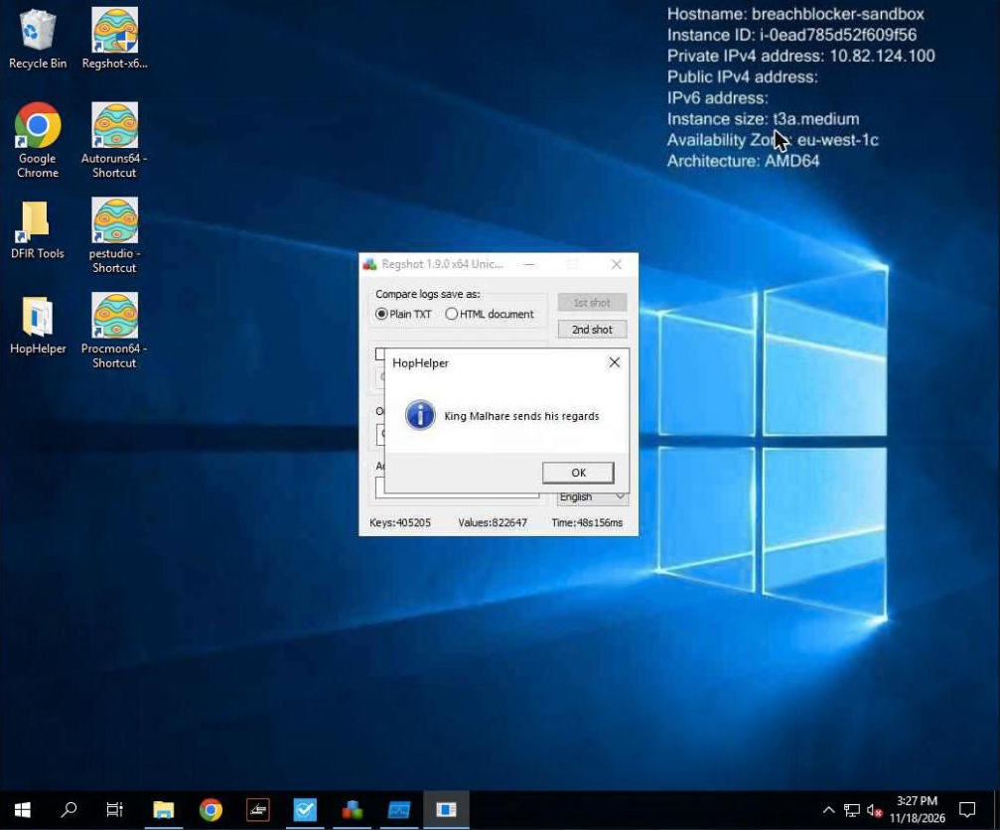
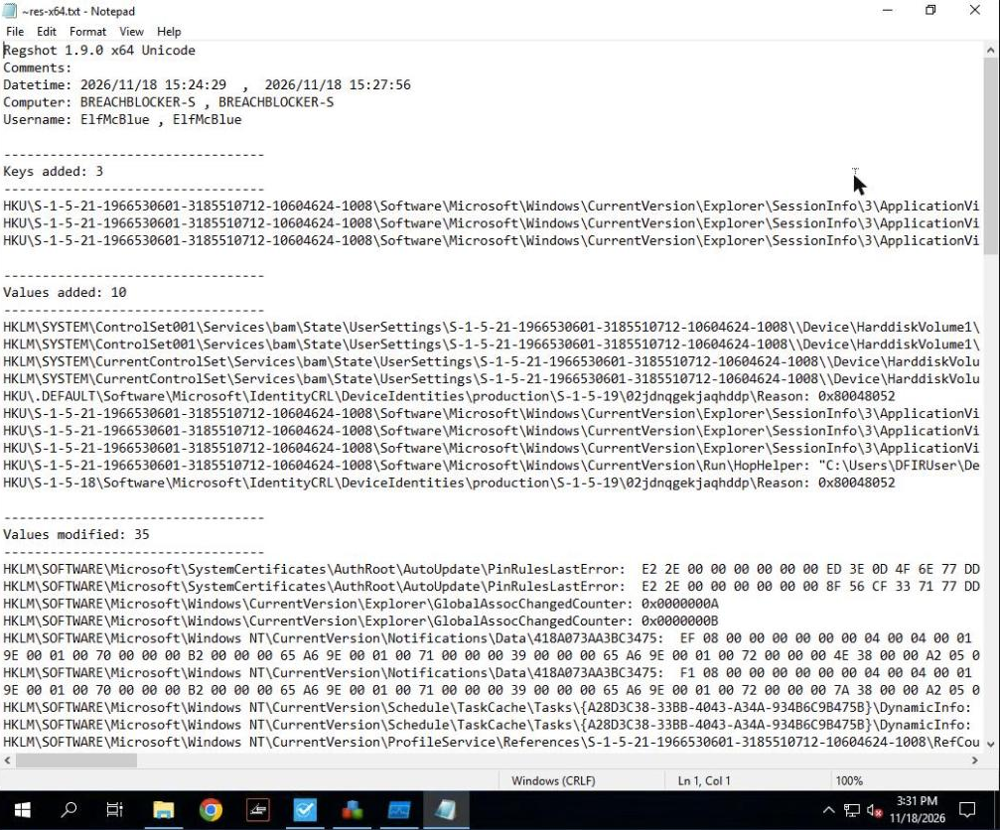
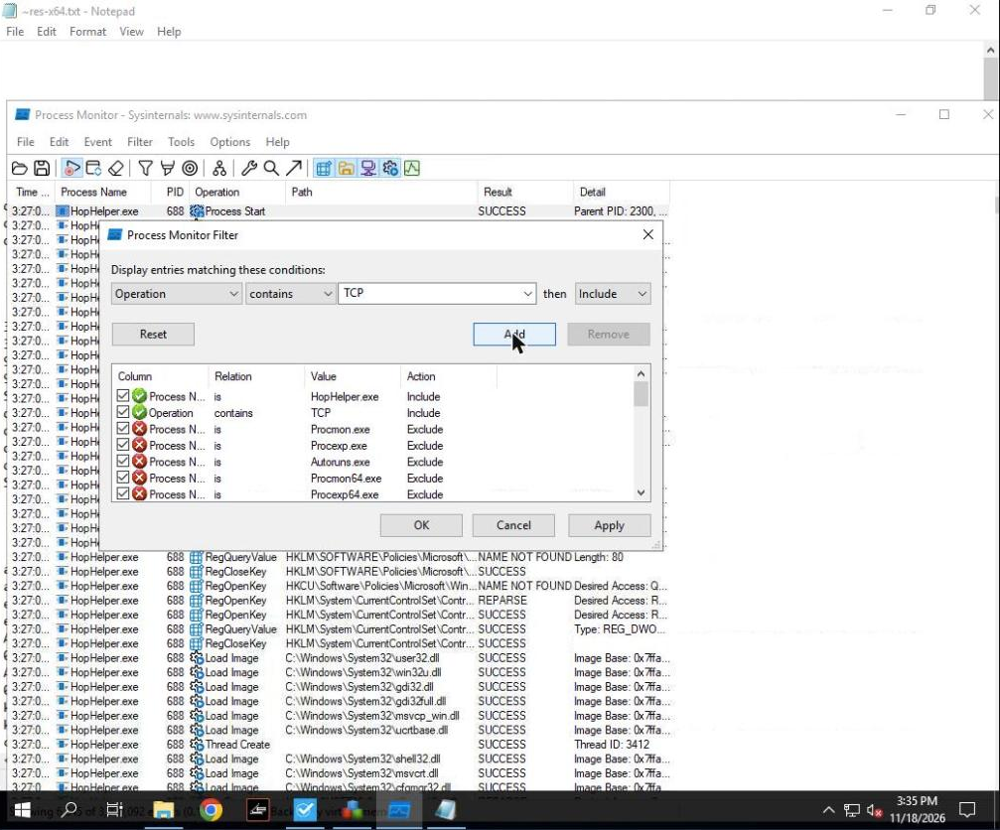
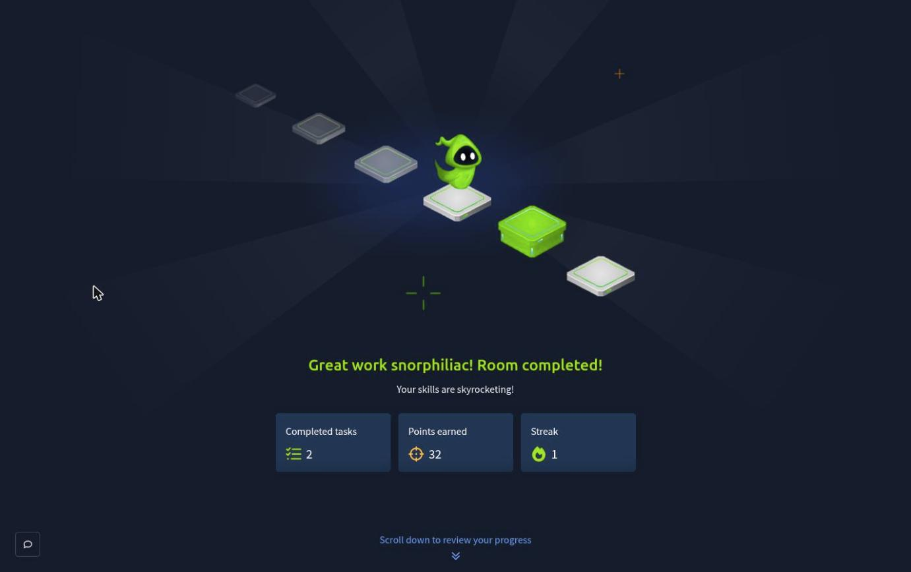

# DIGITAL FORENSICS PRACTICAL REPORT

## Malware Analysis – TryHackMe Lab

| | |
|---|---|
| **Course** | Digital Forensics |
| **Practical** | Malware Analysis Using a Sandbox |
| **Platform** | TryHackMe |
| **Lab** | Malware Analysis – Egg-xecutable |
| **Student Name** | Tandin Zangmo |
| **Student ID** | 02230305 |
| **Date of Submission** | 18 November 2026 |

---

## 1. Introduction

**Malware analysis** is the process of examining a malicious file to understand what it does, how it works and how to defend against it. The results become practical defences: hashes to block, servers to blacklist and artefacts to hunt for on other machines.

A **malware sandbox** is an isolated, disposable machine where suspicious code can run without risking real systems or data. Lab VMs are commonly used because they can be snapshotted and reset. The golden rule is to never run a sample on a device you care about.

**Static analysis** inspects a file *without executing it* (hashes, strings, imports, resources). It is fast and safe, but obfuscation can hide a sample's true behaviour. **Dynamic analysis** *executes* the sample and records what it does to the system (registry, files, processes, network). That shows real behaviour, which is why it must happen inside a sandbox.

**Objectives of investigating HopHelper.exe:**

- Identify the sample by its SHA-256 hash and extract useful strings and indicators.
- Determine whether it establishes persistence on the host.
- Identify its network communication and the protocol it uses.
- Locate the web panel it communicates with (bonus).

## 2. Lab Environment and Tools

| Item | Description |
|---|---|
| Platform | TryHackMe (in-browser lab VM) |
| Operating System | Windows 10 x64 (provided lab machine, hostname `breachblocker-sandbox`) |
| Sample | `HopHelper.exe` (Desktop\HopHelper folder) |
| Static analysis tool | PeStudio 9.61 |
| Registry monitoring tool | Regshot 1.9.0 x64 Unicode |
| Process monitoring tool | Process Monitor (ProcMon), Sysinternals |

  
*Figure 1 – Lab VM desktop with Regshot, PeStudio, ProcMon and the HopHelper folder.*

## 3. Investigation Methodology

### 3.1 Static Analysis Using PEStudio

PeStudio was launched from the Desktop and `HopHelper.exe` was opened with **file > open** (Desktop\HopHelper\HopHelper.exe). The sample was **not** executed at this stage. I reviewed the **footprints** view for hashes and the **strings** view (4,194 strings) for readable content.

| Field | Result |
|---|---|
| File name and type | `HopHelper.exe` – 64-bit Windows PE executable, GUI subsystem, Visual Studio 2015 tooling |
| SHA-256 | `F29C270068F865EF4A747E2683BFA07667BF64E768B38FBB9A2750A3D879CA33` |
| Important strings | Version-info fields: `FileDescription: HopHelper`, `InternalName: HopHelper.dll`, `ProductVersion: 1.0.0` |
| Suspicious indicator | IP address `182.32.133.80` stored in the `LegalCopyright` field |
| Other notes | 15 flagged imports; VirusTotal lookup showed "error" (the lab VM has no internet access) |
| THM flag | `THM{STRINGS_FOUND}` (in the `Comments` and `LegalTrademarks` fields) |

  
*Figure 2 – PeStudio footprints showing `file > sha256`.*

  
*Figure 3 – Bottom of the strings output: the THM flag and the embedded IP address.*

### 3.2 Dynamic Analysis Using Regshot

Regshot was used to compare the registry before and after the sample ran. The output path was set to the Desktop first.

- **First snapshot (baseline):** taken *before* execution to record the clean state of the registry (405,205 keys, 822,647 values).
- **Execution:** `HopHelper.exe` was run from its folder. The desktop shortcut icons changed to Easter-egg icons and a message box appeared saying *"King Malhare sends his regards"*.
- **Second snapshot:** taken *after* execution to record the registry once the sample had acted.
- **Compare:** Regshot diffed the two snapshots and opened the result log (`~res-x64.txt`).

**Changes identified:** 3 keys added, 10 values added and 35 values modified. Most were normal Windows activity (BAM execution records, Explorer SessionInfo). One value was added by the sample under the user's **Run** key:

```
HKU\S-1-5-21-1966530601-3185510712-10604624-1008\Software\Microsoft\Windows\CurrentVersion\Run\HopHelper
  = "C:\Users\DFIRUser\Desktop\HopHelper\HopHelper.exe"
```

**Persistence:** Windows launches every program listed under `...\CurrentVersion\Run` when that user logs in. `HKU\<user SID>` is the same hive as `HKCU`, so HopHelper will restart at every logon and survive reboots (MITRE ATT&CK T1547.001).

   
*Figures 4–5 – Regshot output path set to the Desktop (left) and baseline 1st snapshot completed (right).*

   
*Figures 6–7 – Desktop icons replaced after execution (left) and the sample's message box (right).*

   
*Figures 8–9 – Regshot comparison log with Run\HopHelper under "Values added" (left) and the full value data pointing to HopHelper.exe (right).*

### 3.3 Dynamic Analysis Using ProcMon

**Why ProcMon:** Regshot only shows the end result in the registry. ProcMon records every file, registry, process and network event as it happens, so it shows *how* the sample behaves.

ProcMon was opened before the sample was executed so the run was captured. Capturing was then stopped and two filters were added through **Filter > Filter…**:

1. `Process Name` **is** `HopHelper.exe` → Include (removes system noise)
2. `Operation` **contains** `TCP` → Include (network activity only)

**Process activity observed:** a Process Start (PID 688), DLL loads, queries to `HKLM\System\CurrentControlSet` and policy keys, and a `CreateFile` in the HopHelper folder.

**TCP operations observed:** `TCP Connect` → `TCP Send` (613 bytes) → `TCP Receive` (437 bytes) → `TCP Disconnect`, all with the path `breachblocker-sandbox:49981 -> breachblocker-sandbox:http`.

**Protocol identified:** **HTTP** (destination port 80).

   
*Figures 10–11 – ProcMon filters (left) and HopHelper.exe events: process start, image loads, registry queries (right).*

  
*Figure 12 – TCP events showing communication over HTTP.*

### 3.4 Additional Investigation (Bonus)

ProcMon showed the HTTP traffic going to the sandbox host itself, so I opened `http://localhost` in Chrome on the VM. It hosts a panel titled **"Malhare's InfoCollector – System Information Collector"**. It already listed this machine: hostname `BREACHBLOCKER-S`, user `ElfMcBlue`, OS `Microsoft Windows NT 10.0.17763.0`, 64-bit.

**Indicator:** web panel at `http://localhost` (port 80), "Malhare's InfoCollector".

  
*Figure 13 – Collection panel showing data sent by HopHelper.exe.*

## 4. Investigation Findings

| No. | Investigation | Finding |
|---|---|---|
| 1 | SHA-256 hash | `F29C270068F865EF4A747E2683BFA07667BF64E768B38FBB9A2750A3D879CA33` |
| 2 | THM flag | `THM{STRINGS_FOUND}` |
| 3 | Registry persistence key | `HKU\S-1-5-21-1966530601-3185510712-10604624-1008\Software\Microsoft\Windows\CurrentVersion\Run\HopHelper` |
| 4 | Network communication protocol | HTTP |
| 5 | Web panel (Bonus) | Malhare's InfoCollector – System Information Collector (`http://localhost`) |

## 5. Analysis and Forensic Significance

- **SHA-256 hash:** a unique fingerprint of the file's exact bytes. It can be shared as threat intelligence, added to AV/EDR blocklists and used to search other hosts for the same sample. Recompiling or changing a single byte produces a new hash, so a hash should be combined with behavioural indicators.
- **Strings:** the version information contains a hidden flag and an IP address in fields that would normally hold legal or descriptive text. That suggests the author stores data in metadata where a casual user wouldn't look.
- **Registry modification:** the Run key entry lets the sample restart at every logon without any user action. This is one of the most common persistence techniques, and it gives investigators a clear artefact to hunt for.
- **ProcMon:** it confirmed the sequence of behaviour: the process starts, loads libraries, reads system configuration and then opens a short HTTP session.
- **Network communication:** traffic shows whether data leaves the host and where it goes. That turns into network-level blocks and helps scope the incident.

**Observed vs inferred:**

| Directly observed | Inferred |
|---|---|
| The SHA-256 value, the flag and the IP in the strings | The IP may be attacker infrastructure (not contacted during the lab) |
| Run\HopHelper value pointing to the executable | The sample is intended to persist across reboots |
| One HTTP connect/send/receive to port 80 | The 613-byte send was a beacon carrying host information |
| The panel listing this VM's hostname, user and OS | HopHelper collected and uploaded these details to the panel |
| Icons changed and a message box appeared | Visual effects meant to show compromise (no destructive payload observed) |

## 6. Incident Response Recommendations

1. **Isolate** infected hosts from the network to stop further communication.
2. **Preserve evidence** before cleanup: memory image, disk image, the sample, Regshot/ProcMon logs and the hash, with a chain of custody.
3. **Block indicators:** the SHA-256 hash in EDR/AV, the IP `182.32.133.80` and the panel's address at the firewall/proxy, and unusual HTTP beacons from unsigned binaries.
4. **Remove persistence:** delete the `Run\HopHelper` value, kill the process and delete `HopHelper.exe` and its folder.
5. **Scan and restore:** run a full AV/EDR scan, restore the changed shortcut icons, or reimage from a known-good baseline if integrity is uncertain.
6. **Improve monitoring and awareness:** alert on new Run keys (Sysmon Event ID 13, Autoruns), monitor outbound HTTP, and train users not to run unknown executables.

## 7. Conclusion

I investigated `HopHelper.exe` in a TryHackMe Windows sandbox using PeStudio, Regshot and ProcMon. Static analysis identified the sample (its SHA-256 hash), the flag `THM{STRINGS_FOUND}` and an embedded IP without running it. Dynamic analysis showed that the sample creates a Run key for persistence and sends host information over HTTP to a collection panel ("Malhare's InfoCollector"). The practical showed that static analysis is quick and safe but can only suggest behaviour, while dynamic analysis confirms what the malware actually does. Using both together gives a far more complete picture.

## 8. Limitations

- The sample was observed for only a few minutes, so delayed or scheduled behaviour may have been missed.
- ProcMon shows TCP connections but not their content. No packet capture (e.g. Wireshark) was taken, so the exact HTTP request was not seen.
- The VM had no internet access, so PeStudio's VirusTotal check failed and the IP `182.32.133.80` could not be verified.
- Regshot and ProcMon were running during the same single execution, which added some background noise to both logs.
- Findings are limited to the provided sandbox and may differ on a real host.

## 9. References

1. TryHackMe. *Malware Analysis – Egg-xecutable* (Advent of Cyber 2025). https://tryhackme.com/room/malware-sandbox-aoc2025-SD1zn4fZQt
2. Winitor. *PeStudio*. https://www.winitor.com
3. Microsoft Sysinternals. *Process Monitor*. https://learn.microsoft.com/sysinternals/downloads/procmon
4. Regshot. https://sourceforge.net/projects/regshot/
5. MITRE ATT&CK. *T1547.001 – Registry Run Keys / Startup Folder*. https://attack.mitre.org/techniques/T1547/001/

## 10. Appendices

**Appendix A – Evidence files:** all screenshots (01–14) are provided in the `screenshots` folder and are embedded in Sections 2–3 and below.

**Appendix B – Regshot comparison excerpt (`~res-x64.txt`)**

```
Regshot 1.9.0 x64 Unicode
Datetime: 2026/11/18 15:24:29 , 2026/11/18 15:27:56
Computer: BREACHBLOCKER-S , BREACHBLOCKER-S
Username: ElfMcBlue , ElfMcBlue
Keys added: 3 | Values added: 10 | Values modified: 35
HKU\S-1-5-21-1966530601-3185510712-10604624-1008\Software\Microsoft\Windows\CurrentVersion\Run\HopHelper: "C:\Users\DFIRUser\Desktop\HopHelper\HopHelper.exe"
```

**Appendix C – ProcMon TCP events:** see Section 3.3 and Figure 12 (Connect → Send 613 B → Receive 437 B → Disconnect, port 80/HTTP).

  
*Figure 14 – TryHackMe lab completed.*